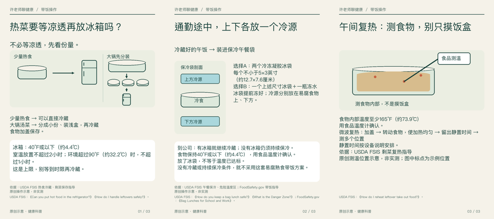
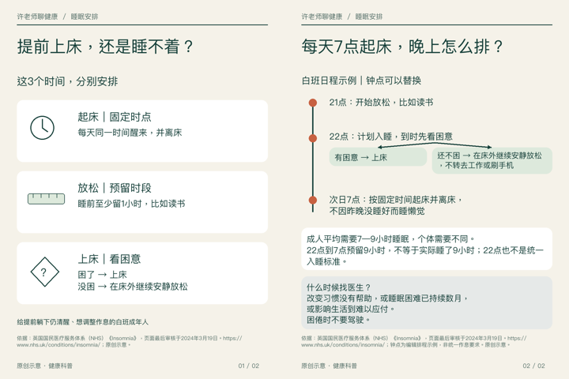

# 两篇由agent实际生产的健康图文

状态：两篇已发布并公开读回（2026-11-05），发布凭据见reports/publication-20261105.json。

## 明天带饭：热菜要等凉透再放冰箱吗？

[全文与来源](p01/article.md) · [最终图片](p01/contact-sheet.png) · [实际图审](p01/actual-review.json)

## 提前上床还是睡不着？把这3个时间分开安排

[全文与来源](p02/article.md) · [最终图片](p02/contact-sheet.png) · [实际图审](p02/actual-review.json)

[完整成品包](health-agent-v3-two-posts.zip) · [模型与交付回执](manifest.json)
